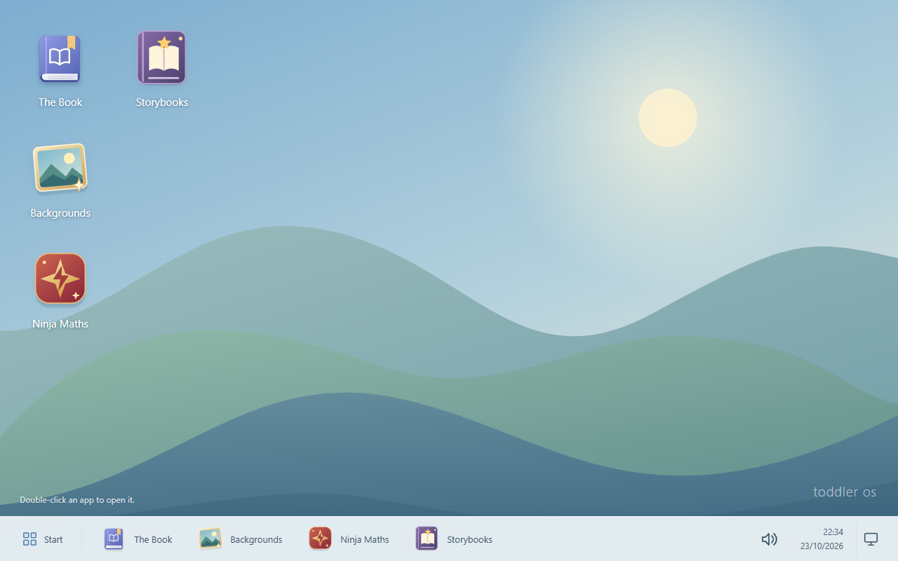
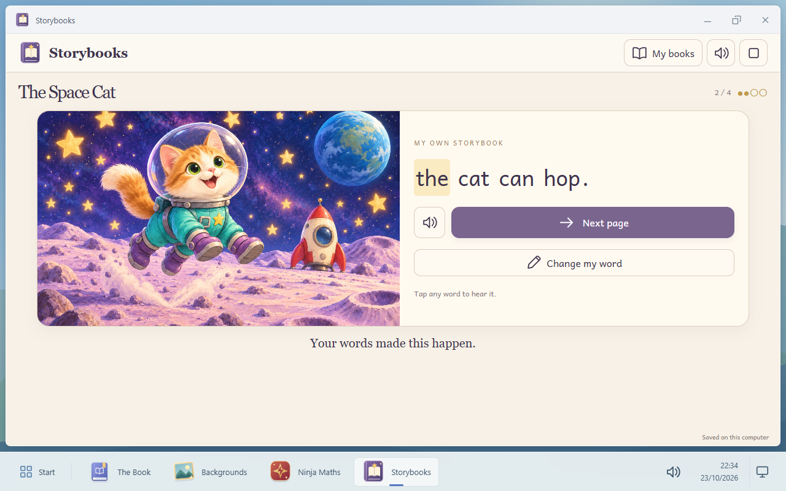

# Toddler OS

## Watch Toddler OS in action

A 30-second tour of the learning apps, phonics feedback, and familiar desktop controls.

https://github.com/user-attachments/assets/e2ac0c64-aa14-4182-89bb-678ecce88361

A small, offline learning desktop for children starting to read, write and count.
Originally built for a five-year-old using a Raspberry Pi, a keyboard and a USB
speaker. A grown-up can also try it on a Windows or Linux computer.

Toddler OS is a local web application that runs on your existing operating system;
it is not a separate Linux distribution.

This is an early application preview. It runs locally, saves locally and has no
accounts, adverts, analytics or cloud speech service.



| App | What children do |
| --- | --- |
| **The Book** | Write stories, hear letter recordings, read words and sentences, and put old stories away without deleting them. |
| **Storybooks** | Type a word such as `hop` or `nap` to choose the next page of an illustrated book. The picture appears and the page reads aloud. |
| **Ninja Maths** | Complete 20 missions: number training, then ten villains with animated finishing moves and trophies. Earn and combine sword, armour and power upgrades. |
| **Mouse Missions** | Programme a mouse through 45 mazes, practise turns and debugging, then learn if/otherwise. Earn mouse equipment along the way. |
| **Backgrounds** | Choose a picture for their desktop. |

Four illustrated stories are included: **The Space Cat**, **Luciana and Dad**,
**Come Back, Cat!** and **Where’s That Cat?**. The two Book Dash titles have
separate original reading/picture editions and typed-choice adaptations.

Optional child unlock words, a moon screensaver and a separate local parent
settings page are included. They do not replace OS account or kiosk restrictions.
See [Mouse Missions](docs/MOUSE-MISSIONS.md) and [unlock settings](docs/SCREEN-LOCK.md).

## Try it on your computer

Install Python, then download this repository using **Code → Download ZIP** and
extract it. Alternatively, clone it with Git. Open a terminal in the extracted
folder and run:

```sh
python run.py
```

With Git, the complete first-run commands are:

```sh
git clone https://github.com/Grandthrax/toddler-os.git
cd toddler-os
python run.py
```

On Windows, use `py -3 run.py` if `python` is unavailable. Open
**http://127.0.0.1:8876/?desktop-preview=1** in Chrome or Chromium. Keep the terminal
open; press Ctrl+C there to stop the application.

No Python packages are needed for this first try. The maths and picture-story
spoken prompts are included. **Letter sounds and reading arbitrary writing need
the optional audio setup below.** An internet connection is needed to obtain the
software and optional voice; normal use is offline afterwards.

Python 3.14 has been tested on Windows and Raspberry Pi OS ARM64. The core app
targets Python 3.12 or later; other platforms and speech package wheels need
testing. This release does not include a prebuilt SD-card image.

## Add reading and letter sounds

Follow [audio setup](docs/AUDIO.md) to install the local British English Piper
voice and add your own A–Z phonics recordings. The private prototype's recording
pack is **not distributed** with this project. Text-to-speech reads words;
separate recordings provide individual letter sounds.

## Using it with a child

Open an app by double-clicking its desktop icon. Use its window controls to
return to the desktop. The speaker control changes this browser's volume.

In **The Book**, make a new story and type. Physical keyboard letters A–Z work;
the on-screen letter buttons show a smaller set chosen by a grown-up. Space,
Enter and Backspace work on screen and on the keyboard. Writing saves
automatically. Select a reading button or click a written word to hear it when
the optional voice is installed. Spoken words are highlighted when timings are
available. **Put away** archives a story; **Bring back** restores it.

In **Storybooks**, open **The Space Cat**. The cover reads aloud. Type one of the
visible word choices, then press Space or Enter. Space reads the chosen word,
the matching picture appears, and the page reads aloud. Finish the choices to
keep a complete picture book. You do not need to copy the whole sentence.



**Luciana and Dad** has five pages: choose `mat` or `hat`, `cat` or `rat`, `drink`
or `sock`, then `sad` or `mad`. The final page, “dad was the best fun”, reads
automatically. Type just the chosen word on each choice page; the full sentence
and matching picture appear afterwards. Luciana is pronounced “Loo-see-ANN-uh”.

The Book Dash adaptations offer short choices such as `sit/run`, `sock/snail`,
`cat/car` and `bug/dad`. Each choice reveals the matching original illustration
and reads our new sentence. These are credited adaptations, with some supported
words beyond the first phonics sounds.

Choose the **book-icon tiles** to read or look. **Come Back, Cat!** preserves the original text with
offline narration and word highlighting. **Where’s That Cat?** preserves the
wordless original: turn its pages and tell your own story aloud. No typing or
invented narration is required. The complete illustrations are fitted inside the
page. Book Dash credits, licence and adaptation notices are available in each
edition. See [the book credits](app/static/storybooks/bookdash/CREDITS.txt).

In **Ninja Maths**, start mission 1. Answer using the pictured choices, number
input or matching activity. Help and another try are available. Finishing a
mission unlocks the next one and awards an upgrade choice. Each of the three
equipment paths has four ranks; ten missions award ten upgrades, so a child can
max out a favourite path. Replaying a completed mission does not award another
upgrade. Progress is saved on this computer.

## Set up a Raspberry Pi

See [the Raspberry Pi guide](docs/RASPBERRY-PI.md) for hardware, installing the
app, sound checks and the difference between a desktop preview and a restricted
child kiosk. This public preview does not change logins, desktop shortcuts or
sudo permissions. Fullscreen Chromium by itself does not prevent access to the
Linux desktop.

## Parent settings and backups

Settings and the database live in `.local/data/`, outside the application source.
See [the parent guide](docs/PARENTS.md) for letter selection, automatic word
reading, backups, recovery and privacy. Do not put this folder on GitHub.

## Development and contributions

Read [CONTRIBUTING.md](CONTRIBUTING.md). Run the backend and asset checks with:

```sh
python -B -m unittest discover -s tests -q
```

There is no frontend build step. The backend uses Python's HTTP server and
SQLite; the frontend is plain HTML, CSS and JavaScript. See
[the architecture notes](docs/ARCHITECTURE.md) and
[the roadmap](docs/ROADMAP.md). Reports from other Pi models, audio devices and
operating systems are welcome. Please keep children's writing out of reports.

## Licence and credits

Application source and original project assets are offered under
**GPL-3.0-only**; see [LICENSE](LICENSE). Andika retains its SIL Open Font License.
The illustrations were made using AI image generation. Piper, the optional voice
model and other dependencies have their own terms. See
[THIRD_PARTY.md](THIRD_PARTY.md) for provenance, exclusions and notices.

The default letter order follows publicly described Read Write Inc. Set 1
guidance. This is an independent family project, not an official or endorsed
Read Write Inc. product. It is a practice tool, not a complete reading curriculum.
